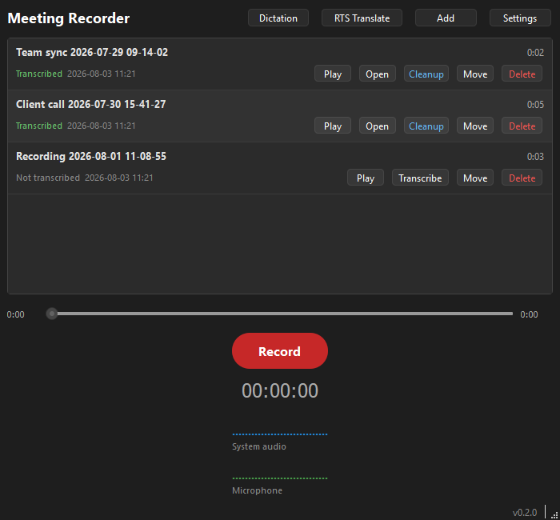
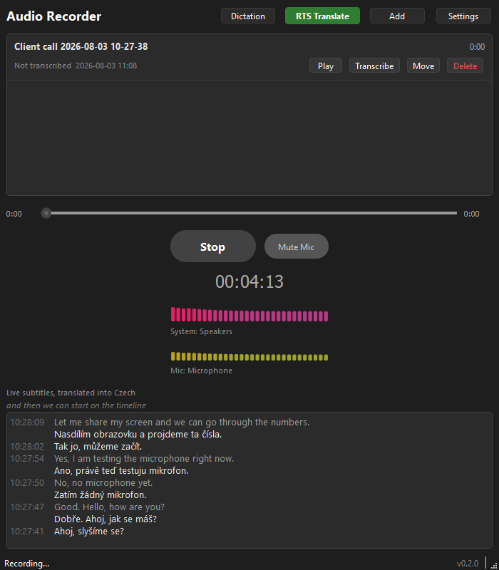
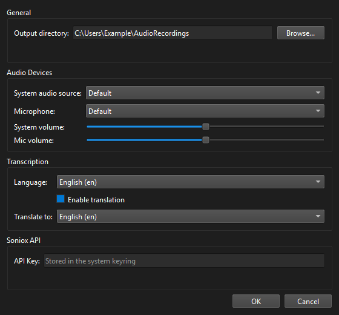

# Meeting Recorder

[](https://github.com/ludekvodicka/MeetingRecorder/actions/workflows/ci.yml)
[](https://github.com/ludekvodicka/MeetingRecorder/actions/workflows/release.yml)
[](https://github.com/ludekvodicka/MeetingRecorder/releases/latest)
[](https://github.com/ludekvodicka/MeetingRecorder/releases)
[](LICENSE)

A desktop application that records a call from both sides at once: what comes out of your
speakers and what goes into your microphone, mixed into one file. Afterwards it can send the
recording to [Soniox](https://soniox.com) for a transcript with speaker labels and
timestamps, and hand that transcript to the Claude CLI for a summary.

It also does push-to-talk dictation. Hold Ctrl+Space anywhere, speak, let go, and the text
appears where your caret is.

Written for Google Meet and Teams calls in Czech and English. It captures system audio
natively on Windows and modern macOS; Linux and older macOS releases have the routing
caveats in the support table below.



## What it does

**Records both sides of a call.** The system output and the microphone are captured as two
separate tracks and mixed when you stop, each with its own volume. You can mute your
microphone mid-recording without stopping. Level meters show both tracks while recording, so
you can tell before the meeting whether the right devices are selected.

**Transcribes.** One click sends a recording to Soniox, which identifies the language, splits
the text by speaker and timestamps it. The result lands next to the recording as a `.md` file.
If translation is on and the call turns out to be in a different language than the one you
configured, you get both: the translation first, the original underneath.

**Summarizes.** If you have the [Claude CLI](https://claude.com/claude-code) installed, the
Cleanup button asks it to read the transcript and write a summary beside it. The prompt is a
setting, so you can ask for whatever shape of summary you want. Without the CLI installed the
button reports that plainly and nothing else breaks.

**Dictates.** Hold Ctrl+Space and speak: the text is transcribed live through Soniox and
pasted where you are typing. Ctrl+Shift+Space translates as it goes. A small pill at the
bottom of the screen shows that it is listening, and your clipboard is put back afterwards.

**Subtitles a call as it happens.** Switch on **RTS Translate** and, while a recording runs,
what the other side says appears under the level meters, newest at the top: the original
above, the translation into your configured language below. A sentence already spoken in
that language is shown once, on its own. The recording is untouched, so the transcript and
the summary still happen afterwards as they always did, and what the subtitles showed is
kept beside the recording as a `.live.md` file.

It is off by default, and it should be: it streams the whole call to Soniox in real time,
and the recording is transcribed again afterwards for the summary. You are billed for both.
The button is green whenever a live session is running, and switching it off ends that
session immediately, mid-recording included.

**Labels speakers live.** Switch on **Live Speakers** to send the microphone and system
audio through separate realtime streams. Microphone speech is labelled **Me**; the remote
track is diarized as **Remote 1**, **Remote 2**, and so on. As labels appear, **Name
Speakers** maps them to participant names. The final mapping applies to the complete call and
is saved as both `.speakers.md` and structured `.speakers.json` after the M4A safely encodes.
Live labels are immediate aids; the later batch transcription remains more accurate. This
feature is off by default and adds up to two paid Soniox realtime streams.

**Offers recording when a meeting appears.** On macOS, stable Teams, Zoom, Webex, and Slack
Huddle windows produce a non-modal recording prompt. An optional least-privilege Chrome/Edge
companion covers Google Meet, Zoom Web, and Teams Web. It can see only those meeting pages,
has no history/tab-capture permission, and reports to `127.0.0.1` only. macOS Calendar is a
separate opt-in signal for imminent events with attendees or a recognized conference link.

Automatic recording is also a separate opt-in. It applies only to a detected app/browser
call, always shows a 10-second **Cancel** countdown, and cancels if the meeting disappears.
A Calendar event by itself never starts recording.



**Keeps the library on disk.** There is no database. An `.m4a` in the output directory is a
recording, a `.md` next to it means it has been transcribed. Rename, move or delete from the
list and the transcript, the summary and the subtitles follow along.



## What works where

The maintainer runs this on Windows. macOS and Linux are built by CI and exercised by the
automated tests, but nobody is using them daily, so treat them as community-supported and
please report what you find.

| | Windows | macOS | Linux |
| --- | --- | --- | --- |
| Microphone recording | yes | yes, asks for permission | yes |
| System audio | yes, straight from the default output | native on macOS 13+; BlackHole fallback | needs a `.monitor` source, see below |
| Transcription and summaries | yes | yes | yes |
| Live subtitles (RTS Translate) | yes | yes on macOS 13+ | only with a monitor source |
| Live speaker labels | yes | yes on macOS 13+ | only with a monitor source |
| Native meeting popup | no | Teams, Zoom, Webex, Slack Huddles | no |
| Browser meeting popup | optional Chrome/Edge companion | optional Chrome/Edge companion | optional Chrome/Edge companion |
| Calendar meeting signal | no | opt-in through EventKit | no |
| Dictation hotkey | yes | yes, needs Accessibility permission | X11 only, not on Wayland |
| Paste after dictation | yes | yes, sends Cmd+V | X11, and needs `xclip` or `xsel` |
| Tested by the maintainer | yes | no | no |

**System audio.** Windows records its default output through WASAPI loopback. On macOS 13 or
newer, leaving the system source on **Default** uses ScreenCaptureKit and needs no virtual
audio device. The first recording asks for Screen & System Audio Recording permission; grant
it in System Settings > Privacy & Security and restart Meeting Recorder when macOS requests
that.

The explicit routed-input choices remain available:

- **Linux** - PulseAudio and pipewire-pulse create a `.monitor` source for every output. Pick
  the monitor of the output you are listening on. If it does not appear in the list, route the
  application to it with `pavucontrol` instead.
- **macOS 12 or an explicit compatibility setup** - install a virtual audio device such as
  [BlackHole](https://github.com/ExistentialAudio/BlackHole), create a multi-output device in
  Audio MIDI Setup that feeds both your speakers and BlackHole, then pick BlackHole here.

On Linux and macOS 12, without a routed system source the recording is microphone-only. The
application says so in the status bar rather than pretending it captured the call.

**Wayland.** No application can watch the keyboard globally on Wayland, so dictation is turned
off there and the button says why. Recording and transcription are unaffected.

## Install

Download the build for your platform from
[Releases](https://github.com/ludekvodicka/MeetingRecorder/releases).

Unless a release explicitly says it is notarized, its builds are unsigned. Check the SHA256
of your download against `SHA256SUMS.txt` in the same release before running it:

```sh
sha256sum Meeting-Recorder-0.2.0-x64.exe                    # Linux or Git Bash
shasum -a 256 Meeting-Recorder-0.2.0-arm64.dmg              # macOS
certutil -hashfile Meeting-Recorder-0.2.0-x64.exe SHA256    # Windows Command Prompt
```

- **Windows** - a single `.exe`, or the same executable in a `.zip`. SmartScreen will warn
  about an unknown publisher.
- **macOS** - a `.dmg`, **Apple Silicon only**, because that is what the build runners are.
  On an Intel Mac, build from source. Gatekeeper refuses unsigned applications, so run
  `xattr -cr "/Applications/Meeting Recorder.app"` after copying it across. The DMG also
  contains the optional unpacked browser companion and a next-meeting quick start. Copy the
  companion folder to a permanent location before loading it in Chrome or Edge.
- **Linux** - an `.AppImage`, or a `.tar.gz` if you prefer to unpack it yourself. Needs
  PulseAudio or pipewire-pulse, and `xclip` or `xsel` for dictation.

The application does not update itself. It checks the Releases page once at startup and tells
you in the status bar when something newer exists.

## Set it up

**Soniox API key.** Transcription and dictation both go through Soniox, which is a paid
service. Create an account, generate a key, and paste it into Settings. It is stored in the
operating system keyring, not in a configuration file. For development or on a machine with no
keyring you can set `SONIOX_API_KEY` in the environment instead, which takes precedence.

**Claude CLI, optional.** Only needed for the Cleanup button. Install
[Claude Code](https://claude.com/claude-code). Shell launches use your PATH; on macOS, Finder
launches also look in the Homebrew and standard Claude/per-user installation locations.

**Audio devices.** Settings lists what your system offers. Leaving both on Default is right for
most Windows machines and for macOS 13 or newer. Devices are remembered by name, so unplugging
and replugging a headset does not silently switch you to a different microphone.

**macOS permissions.** The first recording asks for Microphone and Screen & System Audio
Recording access. After granting screen/audio capture, restart the app. Dictation separately
needs Accessibility access so the global hotkey and Cmd+V can reach other applications.
Calendar access is requested only after its Settings checkbox is enabled; EventKit exposes no
read-only tier, but Meeting Recorder only reads a narrow upcoming-event window and never edits
events.

For a complete install-to-first-call walkthrough, use
[the next-meeting quick start](docs/next-meeting-quick-start.md).

## Your data stays on your machine

Recordings, transcripts and summaries are files in the output directory you choose, and nothing
scans, syncs or uploads them on its own.

Audio leaves your computer only when you ask for it: the Transcribe button uploads that one
recording to Soniox, dictation streams your microphone to Soniox while you hold the key, and
RTS Translate streams the other side of the call to Soniox for as long as it is switched on
and a recording is running. Live Speakers streams the microphone and system tracks to separate
Soniox realtime sessions while its toggle and a recording are active. Meeting detection stays
local: native window titles, optional Calendar events, and sanitized browser-companion
heartbeats are not uploaded.
The Cleanup button runs the Claude CLI on your machine, which sends the transcript to Anthropic
under whatever agreement your Claude account has. Read the privacy terms of both services and
decide whether the calls you record belong there. There is no telemetry and no account of our
own.

The Soniox key is held by the operating system keyring: Credential Manager on Windows, Keychain
on macOS, Secret Service on Linux. Settings live in your user configuration directory
(`%LOCALAPPDATA%\AudioRecorder` on Windows, `~/Library/Application Support/AudioRecorder` on
macOS, `~/.config/AudioRecorder` on Linux), never next to the executable. That directory and
the keyring entry still carry the application's original name, so an upgrade finds the
settings and the key that are already there.

Recording a call may need everyone's consent where you live. That is on you, not on the tool.

## Build from source

Python 3.12 or newer.

```sh
pip install -e ".[dev]"
python -m audiorecorder
```

Checks and packaging:

```sh
ruff check .
pytest
python scripts/build.py package   # writes installers into release/
```

On macOS, PyInstaller ad-hoc signs local builds and `package` smoke-tests the frozen runtime
before creating the DMG. For a distributable Developer ID build, first store a `notarytool`
profile in Keychain, then run:

```sh
MACOS_CODESIGN_IDENTITY="Developer ID Application: Your Name (TEAMID)" \
MACOS_NOTARY_PROFILE="meeting-recorder-notary" \
python scripts/build.py package
```

The command signs with hardened runtime, submits the DMG to Apple, staples the ticket, and
verifies both the ticket and Gatekeeper assessment. Credentials stay in Keychain; the profile
name is the only notarization value passed to the build.

Linux also needs the Qt and PortAudio system libraries; the list CI installs is in
`.github/workflows/ci.yml`. The AppImage step needs `appimagetool` on PATH.

The tests cover the parts that need no hardware: the transcript format, mixing maths, device
selection, native PCM conversion, settings, recording scanner and push-to-talk logic. macOS
CI also builds and starts the frozen runtime in smoke-test mode. Real capture still needs a
machine, and `docs/manual-test-checklist.md` lists what to try before a release.

## Contributing

Bug reports and focused pull requests are welcome, see [CONTRIBUTING.md](CONTRIBUTING.md). For
security issues follow [SECURITY.md](SECURITY.md) rather than opening a public issue.

## Licence

GPL-3.0-only, see [LICENSE](LICENSE). The application links PyQt6, which is itself GPL-3.0, so
the builds are GPL v3 and so is the source. Everything else that ships inside a build is listed
in [THIRD-PARTY.md](THIRD-PARTY.md).
