# Meeting Recorder

[](https://github.com/ludekvodicka/MeetingRecorder/actions/workflows/ci.yml)
[](https://github.com/ludekvodicka/MeetingRecorder/actions/workflows/release.yml)
[](https://github.com/ludekvodicka/MeetingRecorder/releases/latest)
[](https://github.com/ludekvodicka/MeetingRecorder/releases)
[](LICENSE)

A desktop application that records a call from both sides at once: what comes out of your
speakers and what goes into your microphone, mixed into one file. Afterwards it sends the
recording to [Soniox](https://soniox.com) for a transcript with speaker labels and timestamps,
and can hand that transcript to the Claude CLI for a summary. During a call it can show live
translated subtitles or a live transcript labelled by speaker, and between calls it does
push-to-talk dictation into any application.

Written for Google Meet, Teams and Zoom calls in Czech and English. It runs on Windows, macOS
and Linux; the [support table](#what-works-where) lists the platform differences.

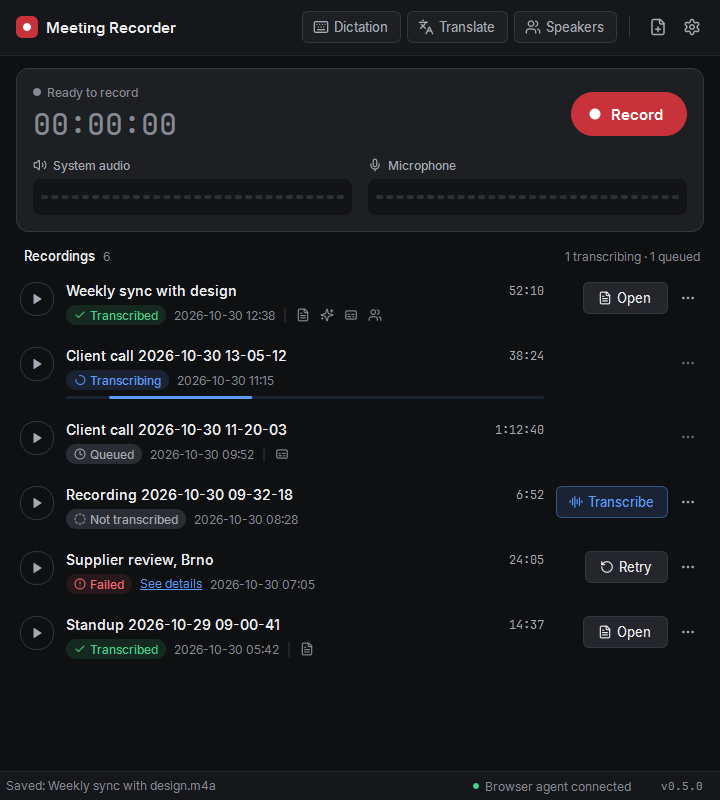

- [What it does](#what-it-does)
- [Settings](#settings)
- [What works where](#what-works-where)
- [Install](#install) · [Updates](#updates) · [Set it up](#set-it-up)
- [Headless transcription](#headless-transcription)
- [Your data stays on your machine](#your-data-stays-on-your-machine)
- [Build from source](#build-from-source)

## What it does

### Records both sides of a call

Press **Record**. The system output and the microphone are captured as two separate tracks
and mixed into one M4A when you stop, each with its own volume. While a recording runs, the
card at the top turns red and shows a pulsing **REC** mark, the elapsed time and two level
meters with the device names, so you can tell at a glance that the right devices are live.

**Mute mic** silences your microphone track without stopping the recording; the card then
shows **Mic muted** and the microphone meter goes flat. A recording without a system audio
source is saved as microphone-only, and the card says so instead of pretending it captured
the call.

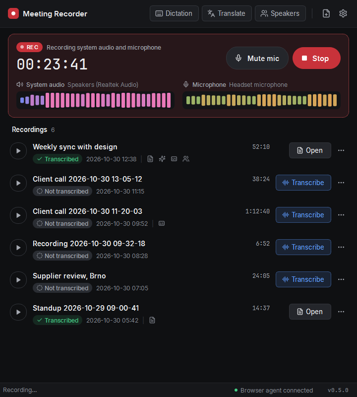

Capture starts and stops outside the GUI thread. Encoding runs in a bounded background queue,
so the next call can start while the previous one is still being saved. Validated audio is
published atomically. If capture cannot shut down cleanly, the card turns to **Stop failed**
with **Retry stop** and **Details**; the audio recorded so far stays on disk. Audio that a
crash or a log-off left behind is encoded at the next start.

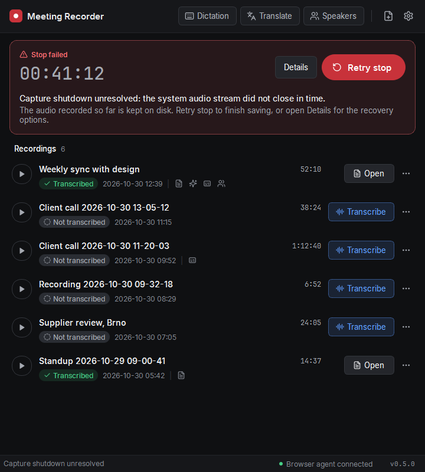

### Keeps a library of your recordings

There is no database. Every `.m4a` in the output folder is a recording, newest first. Each row
shows the name, the duration, the date, a status chip and icons for the files that exist
beside the recording: transcript, AI summary, live subtitles and speaker transcript. Click an
icon to open that file.

Each row offers one action for its state:

| State | Chip | Action |
|---|---|---|
| New recording | Not transcribed | **Transcribe** |
| Interrupted Soniox job | Interrupted | **Resume** |
| Queued or running | Queued, Uploading audio, Transcribing… | none, the row shows progress |
| Done | Transcribed | **Open** the transcript |
| Failed | Failed, with **See details** | **Retry** |

The **⋯** menu holds **Clean up with AI…**, **Move to folder…** and **Delete…**. Delete asks
first and removes the recording with all its side files; Move carries them along.
A recording that is queued or being processed cannot be moved or deleted until its job ends.
**Add** (the file icon in the header) copies existing audio files (m4a, mp3, wav, ogg, flac,
wma, aac) into the library.

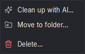

The play button plays a recording inside its row, with a seek bar. A recording that has just
been saved flashes briefly so you can find it.

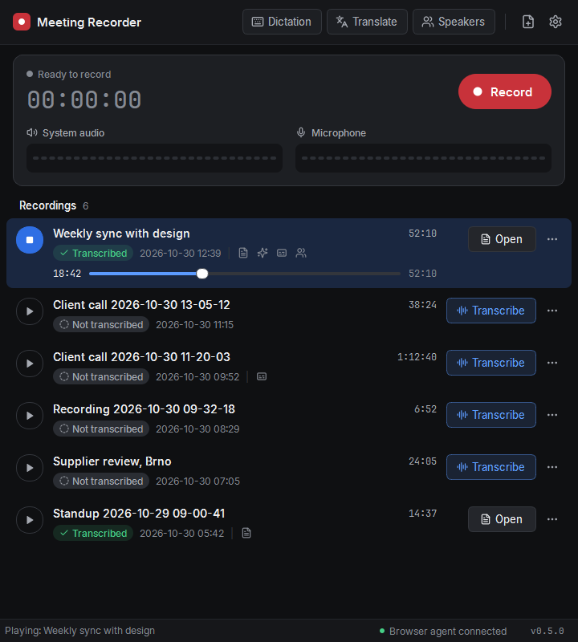

### Transcribes

**Transcribe** sends one recording to Soniox, which identifies the language, splits the text
by speaker and timestamps it. The result is saved beside the recording as a `.md` file. If
translation is on and the call turns out to be in another language than the one you set, you
get both: the translation first, the original underneath. Jobs run one at a time in a queue,
and an interrupted job can be resumed instead of paid for twice (see
[Headless transcription](#headless-transcription) for the recovery rules).

### Summarizes

If the [Claude CLI](https://claude.com/claude-code) is installed, **Clean up with AI…** asks it
to read the transcript and write a summary beside it as `.summary.md`. It asks before it
overwrites an existing summary. The prompt is the `summary_prompt` value in the configuration
file, so you can ask for any shape of summary. Without the CLI the action reports that plainly
and nothing else breaks.

### Subtitles a call as it happens

Switch on **Translate** and, while a recording runs, what the other side says appears in a
live panel above the library, newest line at the top: the original in grey, the translation
into your target language below it. The sentence still being spoken sits in a dashed box
above the finished lines. A sentence already in your target language is shown once. What the
subtitles showed is kept beside the recording as `.live.md`, and the recording itself is
transcribed afterwards as usual.

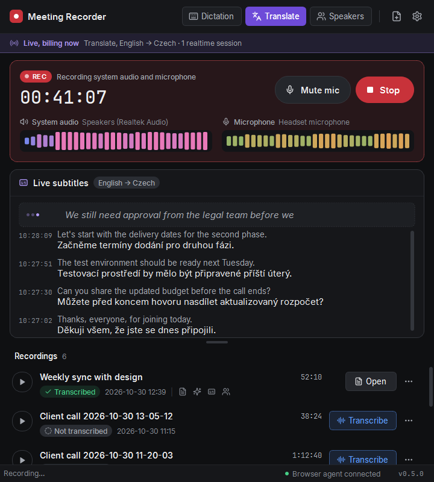

### Labels speakers live

Switch on **Speakers** to send the microphone and the system audio through separate realtime
streams. Your speech is labelled **Me**, the other side is told apart as **Remote 1**,
**Remote 2** and so on, each in its own colour. **Name speakers** maps the remote labels to
participant names; the mapping applies to new lines and to the complete call. After the M4A is
saved, the call is written as `.speakers.md` and structured `.speakers.json`. Live labels are
an aid during the call; the batch transcription afterwards is more accurate.

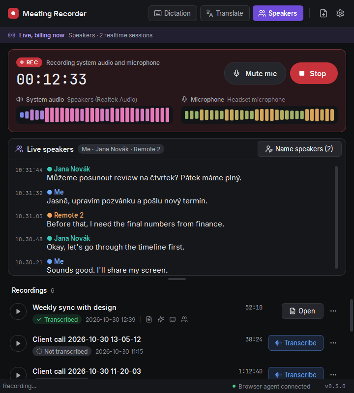

### Shows what costs money

Translate, Speakers and Dictation use paid Soniox realtime minutes, so the window always shows
them. A switched-on function turns its button violet, and a violet strip under the header says
what it means right now:

- **Armed for next recording**: Translate or Speakers will start with the next recording.
- **Live, billing now**: a recording runs with live functions, with the number of realtime
  sessions.
- **Dictation on**: each dictation uses realtime minutes.

Switching a function off ends its session immediately, mid-recording included. All three are
off by default.

### Dictates into any application

Switch on **Dictation**, then hold **Ctrl+Space** anywhere and speak: the text is transcribed
live through Soniox and pasted where your caret is when you let go. **Ctrl+Shift+Space**
translates as it goes. The recorder card shows the shortcuts, the text being heard and the last
paste; a small pill at the bottom of the screen shows that it is listening. Your clipboard is
put back afterwards. Dictation and recording do not run at the same time.

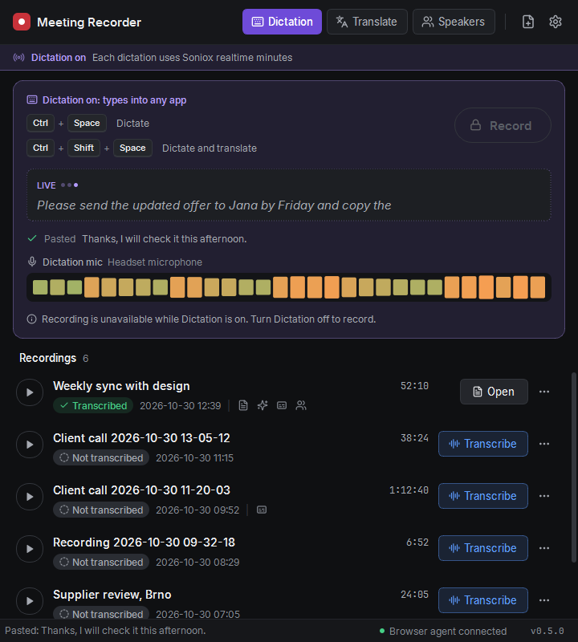

### Offers to record when a meeting starts

With meeting detection on, Meeting Recorder offers a recording when a call appears:

- **Browser meetings** on Windows and macOS: Google Meet, Zoom Web and Teams Web in Brave and
  Chrome, through [Browser Agent](https://github.com/ludekvodicka/BrowserAgentExtension).
  Install it from its release (an extension plus a small native host, registered once with
  `browser-agent-host install`), enable **Agent access** and the wanted **Meetings** tools in
  each browser profile. Meeting Recorder asks every 15 seconds over a local OS channel.
  See [browser detection architecture](docs/architecture/browser-agent-meetings.md).
- **Native apps on macOS**: stable Teams, Zoom, Webex and Slack Huddle windows. Modern Teams is
  also recognized from changes to its local media files' metadata; the detector reads no call
  logs, messages or meeting content.
- **macOS Calendar**, a separate opt-in for imminent events with attendees or a conference link.

The prompt is a small window that stays on top. It names the app and the meeting and says
when a live function will add cost. These signals only offer a recording; they never start or
stop one by themselves.

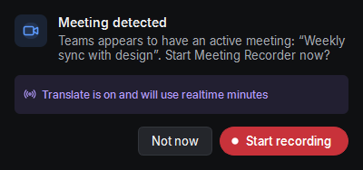

On macOS, qualified Teams and Zoom calls can also start and stop a recording automatically,
after a visible countdown that you can cancel. This is opt-in and needs Accessibility access,
a supervised test and an approval of the tested app version, see
[native lifecycle notes](docs/native-lifecycle.md) and
[the real-call checklist](docs/native-call-test-checklist.md). Approval expires when the app
version or the matcher changes. Unknown or hidden call controls never stop a recording.

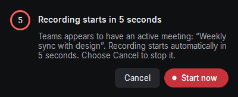
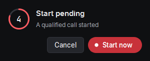

On macOS, closing the main window keeps Meeting Recorder in the menu bar so detection stays
available: its menu starts or stops a recording and opens the app. Prompts can use native
notifications with actions, with the in-app windows as fallback.

### Follows your light or dark theme

The window follows the operating system's colour scheme.

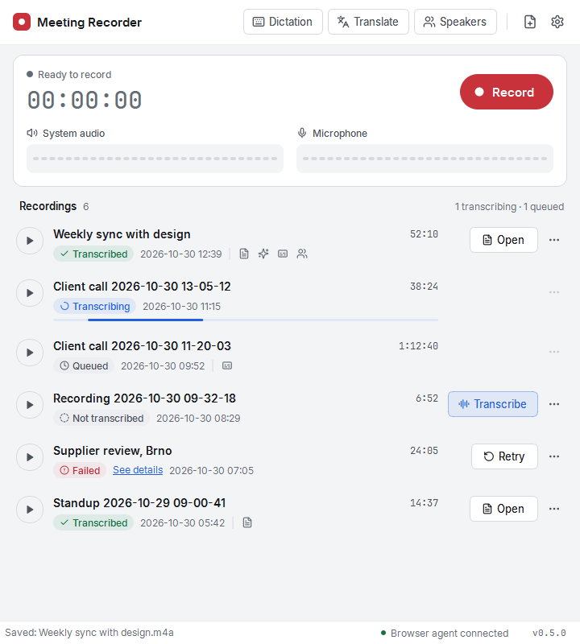

## Settings

Open Settings with the gear icon. **OK** saves, **Cancel** discards. The General tab is what
you see on Windows and Linux; macOS adds the options shown further down.

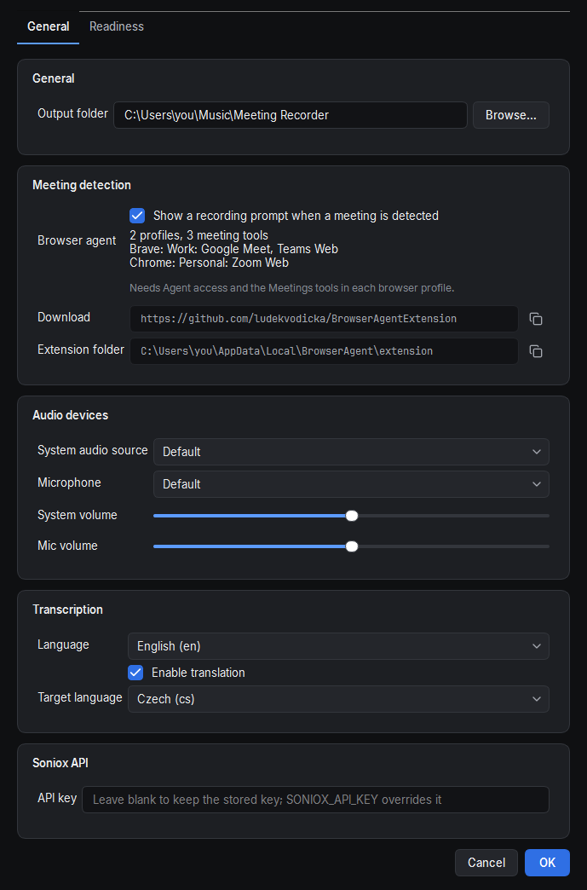

| Group | Setting | What it does |
|---|---|---|
| General | **Output folder** | Where recordings, transcripts and side files are saved. Default `~/AudioRecordings` |
| Meeting detection | **Show a recording prompt when a meeting is detected** | Turns on browser, native and calendar detection. Off by default |
| | **Browser agent** | Shows the connected browser profiles and their enabled meeting tools, or why it is not connected |
| | **Download**, **Extension folder** | The Browser Agent download page and, once installed, the local extension folder to load in the browser. Each has a copy button |
| Audio devices | **System audio source** | Default, None (microphone only), or a specific output or monitor source |
| | **Microphone** | Default or a specific microphone. Devices are remembered by name, so a replugged headset is found again |
| | **System volume**, **Mic volume** | Mix level of each track in the saved file, 0 to 200 % |
| Transcription | **Language** | Czech, English or Auto-detect: the language hint for transcripts, subtitles and dictation |
| | **Enable translation** | Adds a translation to the transcript |
| | **Target language** | English or Czech: the translation language for transcripts, subtitles and Ctrl+Shift+Space |
| Soniox API | **API key** | Stored in the operating system keyring. Leave it blank to keep the stored key; `SONIOX_API_KEY` in the environment overrides it |

On macOS, Settings adds automation, login and native call detection:

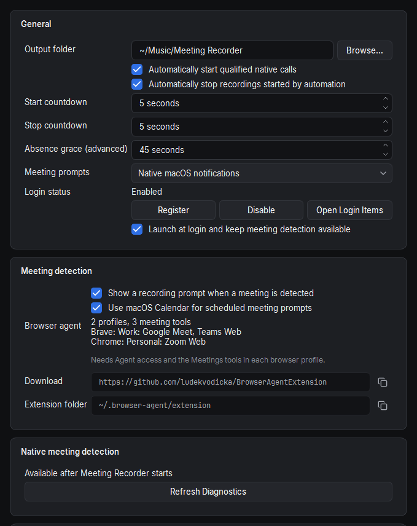

| Group | Setting | What it does |
|---|---|---|
| General | **Automatically start qualified native calls** | Starts a recording for an approved Teams or Zoom call after the start countdown |
| | **Automatically stop recordings started by automation** | Stops such a recording when the call ends, after the stop countdown |
| | **Start countdown**, **Stop countdown** | 5 to 120 seconds, default 5. The countdown window lets you cancel |
| | **Absence grace (advanced)** | How long the call controls may be missing before a stop counts, 15 to 180 seconds, default 45 |
| | **Meeting prompts** | Native macOS notifications or in-app windows |
| | **Login status**, **Launch at login** | Registers the app as a login item so detection is available after sign-in |
| Meeting detection | **Use macOS Calendar for scheduled meeting prompts** | Reads upcoming events with attendees or a conference link. Calendar access is asked for only after you turn this on |
| Native meeting detection | **Inspect native Teams/Zoom call controls** | Reads call-control names through Accessibility, not chat text or participants |
| | Supervised test, diagnostics export, version approval | The steps that qualify one app version for automatic start and stop |

The **Readiness** tab checks what recording and detection need on this computer: notification
and microphone access, the Soniox credential, the last capture test and the native call-control
state. **Test Audio (3 seconds)** makes a short test recording; unattended automatic capture
needs one that passed for the current devices.

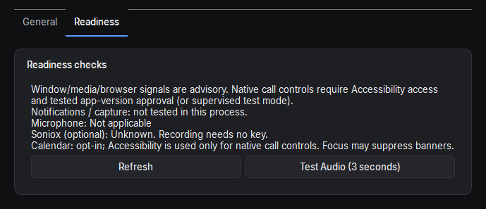

Not in the dialog, only in the configuration file: `summary_prompt`, the instruction given to
the Claude CLI for **Clean up with AI**. The Translate and Speakers buttons remember their
last state; Dictation starts off.

## What works where

The maintainer runs this on Windows. macOS and Linux are built by CI and exercised by the
automated tests, but nobody is using them daily, so treat them as community-supported and
please report what you find.

| | Windows | macOS | Linux |
| --- | --- | --- | --- |
| Microphone recording | yes | yes, asks for permission | yes |
| System audio | yes, straight from the default output | native on macOS 13+; BlackHole fallback | needs a `.monitor` source, see below |
| Transcription and summaries | yes | yes | yes |
| Live subtitles (Translate) | yes | yes on macOS 13+ | only with a monitor source |
| Live speaker labels | yes | yes on macOS 13+ | only with a monitor source |
| Native meeting popup | no | Teams, Zoom, Webex, Slack Huddles | no |
| Automatic start and stop | no | qualified Teams and Zoom versions | no |
| Browser meeting popup | Browser Agent (Brave/Chrome) | Browser Agent (Brave/Chrome) | not supported |
| Calendar meeting signal | no | opt-in through EventKit | no |
| Dictation hotkey | yes | yes, needs Accessibility permission | X11 only, not on Wayland |
| Paste after dictation | yes | yes, sends Cmd+V | X11, and needs `xclip` or `xsel` |
| Tested by the maintainer | yes | no | no |

**System audio.** Windows records its default output through WASAPI loopback. On macOS 13 or
newer, leaving the system source on **Default** uses ScreenCaptureKit and needs no virtual
audio device. The first recording asks for Screen & System Audio Recording permission; grant
it in System Settings > Privacy & Security and restart Meeting Recorder when macOS requests
that.

The explicit routed-input choices remain available:

- **Linux** - PulseAudio and pipewire-pulse create a `.monitor` source for every output. Pick
  the monitor of the output you are listening on. If it does not appear in the list, route the
  application to it with `pavucontrol` instead.
- **macOS 12 or an explicit compatibility setup** - install a virtual audio device such as
  [BlackHole](https://github.com/ExistentialAudio/BlackHole), create a multi-output device in
  Audio MIDI Setup that feeds both your speakers and BlackHole, then pick BlackHole here.

On Linux and macOS 12, without a routed system source the recording is microphone-only, and
the recorder card says so.

**Wayland.** No application can watch the keyboard globally on Wayland, so dictation is turned
off there and its button says why. Recording and transcription are unaffected.

## Install

Download the build for your platform from
[Releases](https://github.com/ludekvodicka/MeetingRecorder/releases).

Unless a release explicitly says it is notarized, its builds are unsigned. Check the SHA256
of your download against `SHA256SUMS.txt` in the same release before running it:

```sh
sha256sum Meeting-Recorder-0.5.0-x64.exe                    # Linux or Git Bash
shasum -a 256 Meeting-Recorder-0.5.0-arm64.dmg              # macOS
certutil -hashfile Meeting-Recorder-0.5.0-x64.exe SHA256    # Windows Command Prompt
```

- **Windows** - a single `.exe`, or the same executable in a `.zip`. SmartScreen will warn
  about an unknown publisher.
- **macOS** - a `.dmg`, **Apple Silicon only**, because that is what the build runners are.
  On an Intel Mac, build from source. Gatekeeper refuses unsigned applications, so run
  `xattr -cr "/Applications/Meeting Recorder.app"` after copying it across. The DMG also
  contains a next-meeting quick start.
- **Linux** - an `.AppImage`, or a `.tar.gz` if you prefer to unpack it yourself. Needs
  PulseAudio or pipewire-pulse, and `xclip` or `xsel` for dictation.

**Browser Agent, optional.** To get the recording offer for Google Meet, Zoom Web and Teams
Web in Brave or Chrome on Windows and macOS, install
[Browser Agent](https://github.com/ludekvodicka/BrowserAgentExtension) from its release.
Recording, transcription and the other functions work without it.

## Updates

Packaged builds check GitHub Releases 45 seconds after start and then every two hours. The
version label at the right of the status bar shows the result: the plain version when there is
nothing new, otherwise the update state. Click it for the release notes and the actions.

The release workflow marks the packages it publishes as official. Official Windows and Linux
AppImage packages download, verify and install a new release themselves; macOS and the
unpacked Linux package only notify. A package you build yourself, or one built in a fork, is
not official and only notifies, so an official release never silently replaces your own
changes. Set `MEETING_RECORDER_BUILD_CHANNEL=official` at build time only when official
releases should replace that build. Source runs do not check.

## Set it up

**Soniox API key.** Transcription, live subtitles, live speakers and dictation all go through
Soniox, which is a paid service. Create an account, generate a key, and paste it into
Settings. It is stored in the operating system keyring, not in a configuration file. For
development or on a machine with no keyring you can set `SONIOX_API_KEY` in the environment
instead, which takes precedence. Recording itself needs no key.

**Claude CLI, optional.** Only needed for Clean up with AI. Install
[Claude Code](https://claude.com/claude-code). Shell launches use your PATH; on macOS, Finder
launches also look in the Homebrew and standard Claude/per-user installation locations.

**Audio devices.** Leaving both on Default is right for most Windows machines and for macOS 13
or newer.

**macOS permissions.** The first recording asks for Microphone and Screen & System Audio
Recording access. After granting screen/audio capture, restart the app. Dictation separately
needs Accessibility access so the global hotkey and Cmd+V can reach other applications.
Calendar access is requested only after its Settings checkbox is enabled; EventKit exposes no
read-only tier, but Meeting Recorder only reads a narrow upcoming-event window and never edits
events. Focus modes can suppress notification banners.

For a complete install-to-first-call walkthrough, use
[the next-meeting quick start](docs/next-meeting-quick-start.md).

## Headless transcription

Transcribe a file without the GUI, from a source checkout with dependencies installed:

```sh
python -m audiorecorder.transcription.cli "/path/to/meeting.m4a" --language auto --json
```

Installing the package also provides `meeting-transcribe` with the same arguments. It uploads
the recording to Soniox using the OS keyring credential or `SONIOX_API_KEY` (which takes
precedence). No GUI, recording device or prompt is used. Credential lookup runs in an isolated
subprocess with a ten-second timeout; on macOS, Keychain interaction is disabled for it. If
access requires approval or unlock, the command exits with an error before any upload. Never
put the key in a command argument, repository or transcript.

- `--language` overrides the app setting; `auto` identifies the language without a hint.
- The command writes the original-language transcript, without translation. To resume a GUI
  job, keep the same language and translation settings.
- `--dry-run` validates the input and destination without reading credentials or uploading.
- `--help` and `--version` are available.

The `.md` beside the audio is published atomically and never overwrites an existing file.
Existing nonempty transcripts are skipped; empty output files need manual review before a
retry. GUI and CLI jobs share an OS lock in `.transcription.lock`; the file stays on disk, but
the OS releases it even after a crash. Do not remove it to bypass an active job. Legacy
`.md.transcribing` files still block processing: check that the old CLI job has stopped before
removing one.

A `.transcription.json` beside the audio saves the remote file and job IDs and settings,
without credentials or transcript content. **Resume** in the app, or the same CLI command with
matching settings, retrieves an existing job after a crash or network failure. Jobs resume only
on explicit action, never automatically at startup. If a submission response was lost before
the job ID was saved, the app stops and asks you to check Soniox rather than submit another
paid job. Interrupted jobs from versions before job IDs were saved cannot be recovered from
local state, and retrying them may incur another charge. Moves, renames and deletes share the
lock and carry the side files along. See
[batch transcription architecture](docs/architecture/batch-transcription.md).

Exit codes: `0` completed/skipped/dry-run, `1` operational failure, `2` invalid input,
`130` interrupted. With `--json`, the final result contains `status`, `audio`, `transcript`
and an optional `message`. Results go to stdout, errors and progress to stderr. Provider error
bodies are not printed because they may contain sensitive data.

## Your data stays on your machine

Recordings, transcripts and summaries are files in the output folder you choose, and nothing
scans, syncs or uploads them on its own.

Audio leaves your computer only when you ask for it: **Transcribe** uploads that one recording
to Soniox, dictation streams your microphone to Soniox while you hold the key, **Translate**
streams the other side of the call while it is on and a recording runs, and **Speakers**
streams the microphone and system tracks to separate Soniox realtime sessions while it is on
and a recording runs. Meeting detection stays local: native window titles, optional Calendar
events and Browser Agent meeting tab metadata are not uploaded. Browser Agent's meeting tools
query only their granted meeting sites; Meeting Recorder requests no other tools or page
content. **Clean up with AI** runs the Claude CLI on your machine, which sends the transcript
to Anthropic under whatever agreement your Claude account has. Read the privacy terms of both
services and decide whether the calls you record belong there. There is no telemetry and no
account of our own.

The Soniox key is held by the operating system keyring: Credential Manager on Windows, Keychain
on macOS, Secret Service on Linux. Settings live in your user configuration directory
(`%LOCALAPPDATA%\AudioRecorder` on Windows, `~/Library/Application Support/AudioRecorder` on
macOS, `~/.config/AudioRecorder` on Linux), never next to the executable. That directory and
the keyring entry still carry the application's original name, so an upgrade finds the
settings and the key that are already there.

Recording a call may need everyone's consent where you live. That is on you, not on the tool.

## Build from source

Python 3.12 or newer.

```sh
pip install -e ".[dev]"
python -m audiorecorder
```

Checks and packaging:

```sh
ruff check .
pytest
python scripts/build.py package   # writes installers into release/
```

On macOS, PyInstaller ad-hoc signs local builds and `package` smoke-tests the frozen runtime
before creating the DMG. The packaging command removes the unpackaged app from `dist/` after
the DMG succeeds so macOS cannot register two app bundles with the same identifier and attach
Screen Recording permission to the wrong copy. Run `build` instead when you explicitly need
the unpackaged app. For a distributable Developer ID build, first store a `notarytool` profile
in Keychain, then run:

```sh
MACOS_CODESIGN_IDENTITY="Developer ID Application: Your Name (TEAMID)" \
MACOS_NOTARY_PROFILE="meeting-recorder-notary" \
python scripts/build.py package
```

The command signs with hardened runtime, submits the DMG to Apple, staples the ticket, and
verifies both the ticket and Gatekeeper assessment. Credentials stay in Keychain; the profile
name is the only notarization value passed to the build.

Linux also needs the Qt and PortAudio system libraries; the list CI installs is in
`.github/workflows/ci.yml`. The AppImage step needs `appimagetool` on PATH.

The tests cover the parts that need no hardware: the transcript format, mixing maths, device
selection, native PCM conversion, settings, the recording scanner, push-to-talk logic and the
window's state handling. macOS CI also builds and starts the frozen runtime in smoke-test mode.
Real capture still needs a machine, and `docs/manual-test-checklist.md` lists what to try before
a release. The look of the interface is described in
[the UI design system](docs/architecture/ui-design-system.md).

## Contributing

Bug reports and focused pull requests are welcome, see [CONTRIBUTING.md](CONTRIBUTING.md). For
security issues follow [SECURITY.md](SECURITY.md) rather than opening a public issue.

## Licence

GPL-3.0-only, see [LICENSE](LICENSE). The application links PyQt6, which is itself GPL-3.0, so
the builds are GPL v3 and so is the source. Everything else that ships inside a build, including
the bundled fonts and icons, is listed in [THIRD-PARTY.md](THIRD-PARTY.md).
